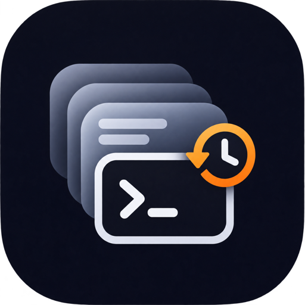
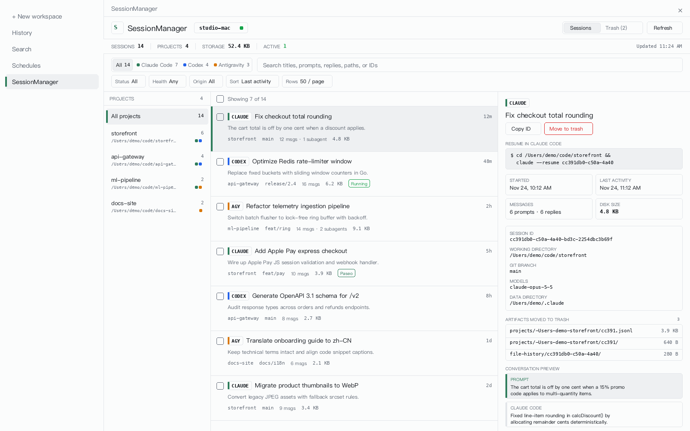
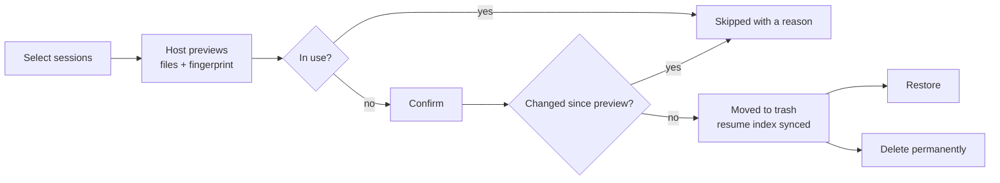
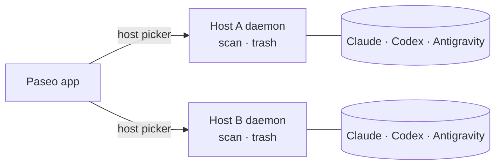

<div align="center">



# SessionManager

**Browse, search, delete, and restore native Claude Code, Codex, and Antigravity sessions from [Paseo](https://paseo.sh).**

English · [简体中文](./README.zh-CN.md)

[](https://github.com/jjayjackie/SessionManager/actions/workflows/ci.yml)
[](https://github.com/jjayjackie/SessionManager/releases)
[](https://paseo.sh)
[](./LICENSE)

<picture>
  <source media="(prefers-color-scheme: dark)" srcset="./assets/screenshots/sessions-en-dark.png">
  
</picture>

<sub>Preview with sample data.</sub>

</div>

## Features

- 🧩 **Multi-agent native support**: manages **Claude Code**, **Codex**, and **Antigravity** sessions in one unified workbench — including sessions started outside Paseo.
- 🗂️ **Unified project grouping**: merges sessions from all three agents that share the same working directory, with per-provider indicators and instant provider tabs (`All` · `Claude Code` · `Codex` · `Antigravity`).
- 🔎 **Fast search & filtering**: full-text search across titles, prompts, replies, paths, branches, and session IDs; filter by status, health, and origin; sort and paginate.
- 🏭 **Clean industrial UI**: built strictly with Paseo theme tokens (`surface0`/`1`/`2`, `border`, `accent`, status tones) in light and dark modes, with a telemetry bar, structured 2×2 metric cards, monospace spec sheet, and responsive desktop/mobile layouts.
- 📋 **One-tap resume**: copies the exact native CLI resume command (`claude --resume`, `codex resume`, or `agy --conversation`) with safe shell quoting and custom config directory env vars when needed.
- 🗑️ **Safe recoverable delete**: two-step preview with SHA-256 file fingerprint verification, per-host trash with byte-identical restore, permanent purge, and automatic resume-index synchronization.
- 🛡️ **Live session protection**: skips sessions held by a live Claude Code PID, an open Antigravity SQLite WAL, a running Paseo agent, or writes within the last 90 s.
- 🌐 **Multi-host native**: every scan, preview, delete, and restore executes on the selected Paseo host's daemon via official plugin RPC.

## Supported agents

| Agent | Discovered directories | Resume command | Moved to trash | Never touched |
| --- | --- | --- | --- | --- |
| **Claude Code** | `$CLAUDE_CONFIG_DIR`, `~/.claude`, Paseo provider profiles | `claude --resume <id>` | `projects/<dir>/<id>.jsonl`, `<id>/`, legacy `agent-*.jsonl`, per-ID `todos/`, `file-history/`, `session-env/`, `debug/`, `tasks/`¹ | `settings.json`, credentials, `history.jsonl`, `CLAUDE.md`, `skills/`, `plugins/`, MCP config, `memory/`, source code |
| **Codex** | `$CODEX_HOME`, `~/.codex`, Paseo provider profiles | `codex resume <id>` | `sessions/.../rollout-...-<id>.jsonl`, `archived_sessions/rollout-...`, per-ID `tui-thread-reference-capabilities/`, `shell_snapshots/`¹ | `auth.json`, `config.toml`, `history.jsonl`, `skills/`, `plugins/`, `state_5.sqlite`, `models_cache.json`, source code |
| **Antigravity** | `$ANTIGRAVITY_DATA_DIR`, `$ANTIGRAVITY_CLI_DIR`, `~/.gemini/antigravity-cli`, `~/.gemini/antigravity`, Paseo provider profiles | `agy --conversation <id>` | `conversations/<id>.db`, `brain/<id>/`, `annotations/<id>.pbtxt`, `presence/<id>.lock` | `settings.json`, `builtin/`, `bin/`, `history.jsonl`, `conversation_summaries.db`, auth cache, source code |

¹ Retained automatically while another session record in the same root still references the same session ID.

## Install

Requires Paseo **0.13.0+**, with **Settings → Plugins → Enable plugins** turned on. Install on every host you want to manage:

```bash
paseo plugin add git:jjayjackie/SessionManager
paseo --host <url> plugin add git:jjayjackie/SessionManager   # a remote host
```

Then open **SessionManager** in the sidebar, or press <kbd>⌘K</kbd> / <kbd>Ctrl+K</kbd>.

<details>
<summary>Install from a release archive instead</summary>

```bash
curl -LO https://github.com/jjayjackie/SessionManager/releases/latest/download/SHA256SUMS.txt
curl -LO https://github.com/jjayjackie/SessionManager/releases/download/v0.2.2/session-manager-0.2.2.tar.gz
shasum -a 256 -c SHA256SUMS.txt --ignore-missing
mkdir -p ~/paseo-plugins && tar -xzf session-manager-0.2.2.tar.gz -C ~/paseo-plugins
paseo plugin install ~/paseo-plugins/session-manager
paseo plugin ls   # should report "running"
```

</details>

## How deleting works



The trash is stored on the same host in `$PASEO_HOME/plugin-data/session-manager/trash/`. Paths are checked against a fixed per-provider allowlist, symbolic links are never followed, and only one mutation runs at a time per host.

## Multiple hosts



All work runs on the selected host through Paseo's plugin RPC. The plugin opens no extra ports. Data from one host is never shown for another, and an offline host keeps its last view until it reconnects.

## Development

Installs, boundary audits, type checks, linting, tests, bundling, CodeQL, packaging, and releases all run in [GitHub Actions](./.github/workflows/ci.yml) on GitHub-hosted runners. Tags `v*` publish a [release](https://github.com/jjayjackie/SessionManager/releases). Tests use isolated synthetic sessions for Claude Code, Codex, and Antigravity.

## Acknowledgements

- Built on [**Session usage**](https://paseo.sh/plugins/panrafal/session-usage) from [panrafal/paseo-plugins](https://github.com/panrafal/paseo-plugins) (MIT). Directory discovery and Paseo agent-record reading are adapted from it.
- [Paseo](https://github.com/getpaseo/paseo) and its [plugin guide](https://paseo.sh/docs/plugins), [SDK reference](https://paseo.sh/docs/plugins/reference), and [plugin registry](https://github.com/getpaseo/plugins).
- [GitHub Actions](https://docs.github.com/en/actions) for cloud-hosted verification, packaging, and releases.

## License

[MIT](./LICENSE). © panrafal (original work) and jjayjackie.
