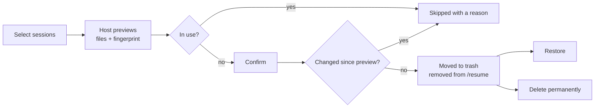
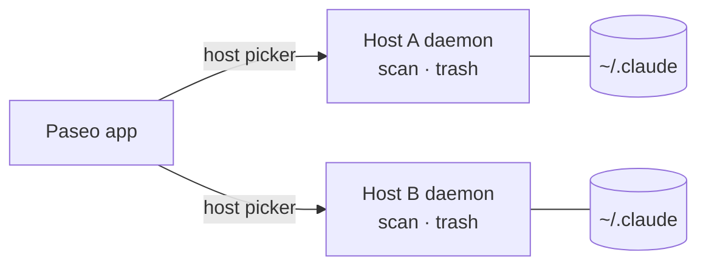

<div align="center">

# ClaudeSession

**Browse, search, delete and restore native Claude Code sessions from [Paseo](https://paseo.sh).**

English · [简体中文](./README.zh-CN.md)

[](https://github.com/jjayjackie/ClaudeSession/actions/workflows/ci.yml)
[](https://github.com/jjayjackie/ClaudeSession/releases)
[](https://paseo.sh)
[](./LICENSE)

<picture>
  <source media="(prefers-color-scheme: dark)" srcset="./assets/screenshots/sessions-en-dark.png">
  
</picture>

<sub>Screenshot with sample data.</sub>

</div>

## Features

- 🗂️ **Every Claude directory**: `~/.claude`, `CLAUDE_CONFIG_DIR`, and Paseo provider profiles, including sessions started outside Paseo.
- 🔎 **Find anything**: group by project, search titles, prompts and replies, then filter, sort and page through the results.
- 📋 **Details at a glance**: branch, timing, models, size, files on disk, forks and duplicate IDs, and a one-tap `claude --resume` command.
- 🗑️ **Safe delete**: preview, then confirm. Deleted sessions go to a trash you can restore from, and they drop out of `/resume`.
- 🛡️ **Protected while in use**: sessions held by a live Claude Code process, a running Paseo agent, or a write in the last 90 s are skipped.
- 🌐 **Every host**: each Paseo host scans and keeps its own trash. Switch hosts with Paseo's host picker.
- 🎨 **Native look**: Paseo theme colors in light and dark, layouts for desktop and phone, English and 简体中文.

## Install

Requires Paseo **0.13.0+**, with **Settings → Plugins → Enable plugins** turned on. Install on every host you want to manage:

```bash
paseo plugin add git:jjayjackie/ClaudeSession
paseo --host <url> plugin add git:jjayjackie/ClaudeSession   # a remote host
```

Then open **ClaudeSession** in the sidebar, or press <kbd>⌘K</kbd> / <kbd>Ctrl+K</kbd>.

<details>
<summary>Install from a release archive instead</summary>

```bash
curl -LO https://github.com/jjayjackie/ClaudeSession/releases/latest/download/SHA256SUMS.txt
curl -LO https://github.com/jjayjackie/ClaudeSession/releases/download/v0.1.1/claude-session-manager-0.1.1.tar.gz
shasum -a 256 -c SHA256SUMS.txt --ignore-missing
mkdir -p ~/paseo-plugins && tar -xzf claude-session-manager-0.1.1.tar.gz -C ~/paseo-plugins
paseo plugin install ~/paseo-plugins/claude-session-manager
paseo plugin ls   # should report "running"
```

</details>

## How deleting works



| Moved to the trash | Never touched |
| --- | --- |
| `projects/<dir>/<id>.jsonl` and `projects/<dir>/<id>/`<br/>older `agent-*.jsonl` subagents<br/>`todos/`, `file-history/`, `session-env/`, `debug/`, `tasks/` entries for that ID¹ | settings, credentials, `history.jsonl`<br/>`CLAUDE.md`, skills, plugins, MCP config<br/>project `memory/`, your source code |

¹ Kept while another transcript still uses the same session ID.

The trash is stored on the same host in `$PASEO_HOME/plugin-data/claude-session-manager/trash/`. Paths are allowlisted, symbolic links are never followed, and only one change runs at a time on each host.

## Multiple hosts



All work runs on the selected host through Paseo's plugin RPC. The plugin opens no extra ports. Data from one host is never shown for another, and an offline host keeps its last view until it reconnects.

## Development

Installs, type checks, linting, tests, bundling and releases all run in [GitHub Actions](./.github/workflows/ci.yml) on GitHub-hosted runners. Tags `v*` publish a [release](https://github.com/jjayjackie/ClaudeSession/releases). Tests use synthetic sessions only. Things CI cannot check, such as rendering in the app, host switching and `/resume` in a real Claude Code, need a manual pass.

## Acknowledgements

- Built on [**Session usage**](https://paseo.sh/plugins/panrafal/session-usage) from [panrafal/paseo-plugins](https://github.com/panrafal/paseo-plugins) (MIT). Claude directory discovery and the Paseo agent-record reader are adapted from it.
- [Paseo](https://github.com/getpaseo/paseo) and its [plugin guide](https://paseo.sh/docs/plugins), [SDK reference](https://paseo.sh/docs/plugins/reference) and [plugin registry](https://github.com/getpaseo/plugins).

## License

[MIT](./LICENSE). © panrafal (original work) and jjayjackie.
