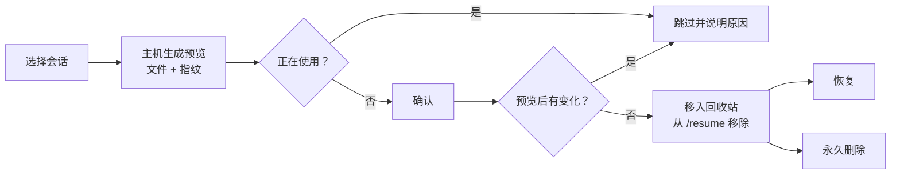
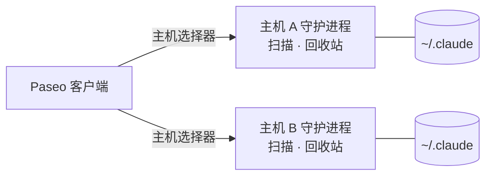

<div align="center">

# ClaudeSession

**在 [Paseo](https://paseo.sh) 中浏览、搜索、删除和恢复 Claude Code 原生会话。**

[English](./README.md) · 简体中文

[](https://github.com/jjayjackie/ClaudeSession/actions/workflows/ci.yml)
[](https://github.com/jjayjackie/ClaudeSession/releases)
[](https://paseo.sh)
[](./LICENSE)


<sub>示例数据截图。</sub>

</div>

## 功能

- 🗂️ **覆盖所有 Claude 目录**：`~/.claude`、`CLAUDE_CONFIG_DIR` 和 Paseo Provider 配置，Paseo 之外启动的会话也包括在内。
- 🔎 **快速查找**：按项目分组，全文搜索标题、提问和回复，支持筛选、排序和分页。
- 📋 **详情一目了然**：分支、时间、模型、大小、磁盘文件、分叉与重复 ID，一键复制 `claude --resume` 命令。
- 🗑️ **安全删除**：先预览再确认。删除的会话进入回收站，可随时恢复，并且不再出现在 `/resume` 中。
- 🛡️ **使用中自动保护**：正被 Claude Code 进程或运行中的 Paseo Agent 使用、或 90 秒内有写入的会话会被跳过。
- 🌐 **多主机**：每台主机独立扫描、独立回收站，用 Paseo 主机选择器切换。
- 🎨 **原生体验**：使用 Paseo 主题色，支持深浅色，适配桌面和手机，支持中英文。

## 安装

需要 Paseo **0.13.0+**，并在 **设置 → 插件** 中打开 **启用插件**。在每台需要管理的主机上安装：

```bash
paseo plugin add git:jjayjackie/ClaudeSession
paseo --host <地址> plugin add git:jjayjackie/ClaudeSession   # 远程主机
```

安装后在侧边栏打开 **ClaudeSession**，或按 <kbd>⌘K</kbd> / <kbd>Ctrl+K</kbd> 搜索。

<details>
<summary>改用 Release 压缩包安装</summary>

```bash
curl -LO https://github.com/jjayjackie/ClaudeSession/releases/latest/download/SHA256SUMS.txt
curl -LO https://github.com/jjayjackie/ClaudeSession/releases/download/v0.1.1/claude-session-manager-0.1.1.tar.gz
shasum -a 256 -c SHA256SUMS.txt --ignore-missing
mkdir -p ~/paseo-plugins && tar -xzf claude-session-manager-0.1.1.tar.gz -C ~/paseo-plugins
paseo plugin install ~/paseo-plugins/claude-session-manager
paseo plugin ls   # 状态应为 running
```

</details>

## 删除流程



| 移入回收站 | 绝不改动 |
| --- | --- |
| `projects/<目录>/<id>.jsonl` 与 `projects/<目录>/<id>/`<br/>旧版 `agent-*.jsonl` 子 Agent<br/>该 ID 在 `todos/`、`file-history/`、`session-env/`、`debug/`、`tasks/` 中的条目¹ | 设置、登录凭据、`history.jsonl`<br/>`CLAUDE.md`、Skills、插件、MCP 配置<br/>项目 `memory/`、项目源码 |

¹ 若还有其他记录使用相同会话 ID，则先保留。

回收站保存在同一主机的 `$PASEO_HOME/plugin-data/claude-session-manager/trash/`。所有路径都经过白名单校验，不跟随符号链接，每台主机同一时间只执行一个修改操作。

## 多主机



所有操作都通过 Paseo 插件 RPC 在所选主机上执行，不额外开放端口。不同主机的数据互不混用；主机离线时保留最后的视图，重连后自动刷新。

## 开发

依赖安装、类型检查、Lint、测试、打包和发布全部在 [GitHub Actions](./.github/workflows/ci.yml) 的托管 Runner 上完成。推送 `v*` 标签会发布 [Release](https://github.com/jjayjackie/ClaudeSession/releases)。测试只使用模拟会话。CI 无法覆盖的部分需要人工验证，例如客户端显示效果、主机切换，以及真实 Claude Code 中的 `/resume`。

## 致谢

- 基于 [panrafal/paseo-plugins](https://github.com/panrafal/paseo-plugins) 中的 [**Session usage**](https://paseo.sh/plugins/panrafal/session-usage)（MIT）二次开发，Claude 目录发现和 Paseo Agent 记录读取逻辑改编自该项目。
- [Paseo](https://github.com/getpaseo/paseo) 及其[插件开发指南](https://paseo.sh/docs/plugins)、[SDK 参考](https://paseo.sh/docs/plugins/reference)、[插件注册表](https://github.com/getpaseo/plugins)。

## 许可证

[MIT](./LICENSE)。© panrafal（原始作品）与 jjayjackie。
