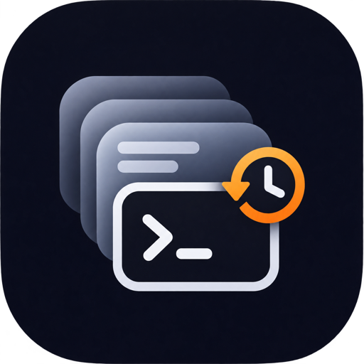
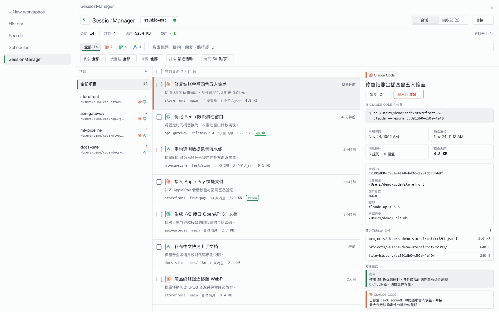
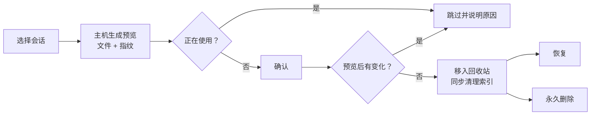
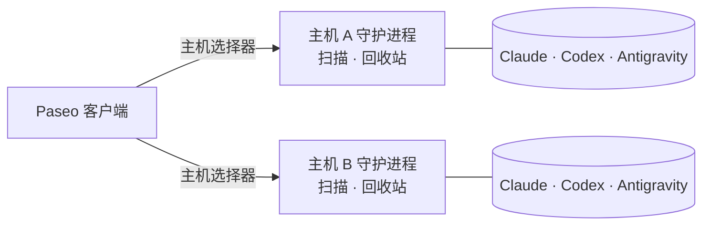

<div align="center">



# SessionManager

**在 [Paseo](https://paseo.sh) 中统一浏览、搜索、删除和恢复 Claude Code、Codex 与 Antigravity 原生历史会话。**

[English](./README.md) · 简体中文

[](https://github.com/jjayjackie/SessionManager/actions/workflows/ci.yml)
[](https://github.com/jjayjackie/SessionManager/releases)
[](https://paseo.sh)
[](./LICENSE)



<sub>示例数据预览图。</sub>

</div>

## 功能

- 🧩 **多引擎原生适配**：在同一界面统一管理 **Claude Code**、**Codex** 与 **Antigravity** 的原生会话记录，包括在 Paseo 之外直接通过终端启动的会话。
- 🗂️ **跨引擎统一项目分组**：共享同一工作目录的各引擎会话自动合并至同一项目条目，带引擎色标指示，并支持顶部一键切换（`全部` · `Claude Code` · `Codex` · `Antigravity`）。
- 🔎 **高速检索与筛选**：全文搜索标题、提问、回复、工作目录、分支与会话 ID；支持状态、完整性、来源筛选以及排序和分页。
- 🏭 **简洁工业风界面**：完全采用 Paseo 原生主题 Token（支持深浅色），顶部集成指标状态带、分段引擎切换栏，右侧采用 2×2 结构化数据卡片、等宽参数面板与终端恢复指令区，适配桌面与移动端。
- 📋 **一键复制恢复命令**：按引擎自动生成带安全引号转义的 CLI 恢复命令（`claude --resume`、`codex resume`、`agy --conversation`），非默认配置目录自动补全环境变量。
- 🗑️ **安全可恢复删除**：两步预览并校验 SHA-256 文件指纹，每台主机独立回收站支持字节级原样恢复与永久清除，并同步维护各引擎的会话索引。
- 🛡️ **运行中自动保护**：正在被活跃 Claude Code 进程、打开中的 Antigravity WAL 数据库、运行中 Paseo Agent 使用，或 90 秒内有写入的会话自动跳过。
- 🌐 **原生多主机架构**：所有扫描、预览、删除和恢复均通过 Paseo 插件 RPC 在目标主机守护进程内完成，主机间数据严格隔离。

## 支持的 Agent

| Agent | 扫描目录 | 恢复命令 | 移入回收站的文件 | 绝不改动 |
| --- | --- | --- | --- | --- |
| **Claude Code** | `$CLAUDE_CONFIG_DIR`、`~/.claude`、Paseo Provider 配置 | `claude --resume <id>` | `projects/<目录>/<id>.jsonl`、`<id>/`、旧版 `agent-*.jsonl`；该 ID 在 `todos/`、`file-history/`、`session-env/`、`debug/`、`tasks/` 中的条目¹ | `settings.json`、登录凭据、`history.jsonl`、`CLAUDE.md`、`skills/`、`plugins/`、MCP 配置、`memory/`、项目源码 |
| **Codex** | `$CODEX_HOME`、`~/.codex`、Paseo Provider 配置 | `codex resume <id>` | `sessions/.../rollout-...-<id>.jsonl`、`archived_sessions/rollout-...`；该 ID 在 `tui-thread-reference-capabilities/`、`shell_snapshots/` 中的条目¹ | `auth.json`、`config.toml`、`history.jsonl`、`skills/`、`plugins/`、`state_5.sqlite`、`models_cache.json`、项目源码 |
| **Antigravity** | `$ANTIGRAVITY_DATA_DIR`、`$ANTIGRAVITY_CLI_DIR`、`~/.gemini/antigravity-cli`、`~/.gemini/antigravity`、Paseo Provider 配置 | `agy --conversation <id>` | `conversations/<id>.db`、`brain/<id>/`、`annotations/<id>.pbtxt`、`presence/<id>.lock` | `settings.json`、`builtin/`、`bin/`、`history.jsonl`、`conversation_summaries.db`、登录缓存、项目源码 |

¹ 当同一根目录下仍有其他记录共用该会话 ID 时自动保留共享文件。

## 安装

需要 Paseo **0.13.0+**，并在 **设置 → 插件** 中打开 **启用插件**。在每台需要管理的主机上安装：

```bash
paseo plugin add git:jjayjackie/SessionManager
paseo --host <地址> plugin add git:jjayjackie/SessionManager   # 远程主机
```

安装后在侧边栏打开 **SessionManager**，或按 <kbd>⌘K</kbd> / <kbd>Ctrl+K</kbd> 快速搜索。

<details>
<summary>改用 Release 压缩包安装</summary>

```bash
curl -LO https://github.com/jjayjackie/SessionManager/releases/latest/download/SHA256SUMS.txt
curl -LO https://github.com/jjayjackie/SessionManager/releases/download/v0.2.2/session-manager-0.2.2.tar.gz
shasum -a 256 -c SHA256SUMS.txt --ignore-missing
mkdir -p ~/paseo-plugins && tar -xzf session-manager-0.2.2.tar.gz -C ~/paseo-plugins
paseo plugin install ~/paseo-plugins/session-manager
paseo plugin ls   # 状态应为 running
```

</details>

## 删除流程



回收站保存在同一主机的 `$PASEO_HOME/plugin-data/session-manager/trash/`。所有路径均按引擎白名单严格校验，绝不跟随符号链接，每台主机同一时间仅执行一个修改操作。

## 多主机



所有操作均通过 Paseo 插件 RPC 在所选主机上执行，不额外开放端口。不同主机的数据互不混用；主机离线时保留最后加载的视图，重连后自动刷新。

## 开发

依赖安装、边界审计、类型检查、Lint、单元测试、esbuild 打包检查、CodeQL、产物归档与 Release 发布全部在 [GitHub Actions](./.github/workflows/ci.yml) 的云端托管 Runner 上完成。推送 `v*` 标签自动发布 [Release](https://github.com/jjayjackie/SessionManager/releases)。测试全部使用隔离的 Claude Code、Codex 与 Antigravity 模拟会话数据。

## 致谢

- 基于 [panrafal/paseo-plugins](https://github.com/panrafal/paseo-plugins) 中的 [**Session usage**](https://paseo.sh/plugins/panrafal/session-usage)（MIT）演进而来，目录发现与 Paseo Agent 记录读取逻辑改编自该项目。
- [Paseo](https://github.com/getpaseo/paseo) 及其[插件开发指南](https://paseo.sh/docs/plugins)、[SDK 与国际化参考](https://paseo.sh/docs/plugins/reference)、[插件注册表](https://github.com/getpaseo/plugins)。
- [GitHub Actions](https://docs.github.com/en/actions) 提供云端持续验证、打包与发布能力。

## 许可证

[MIT](./LICENSE)。© panrafal（原始作品）与 jjayjackie。
